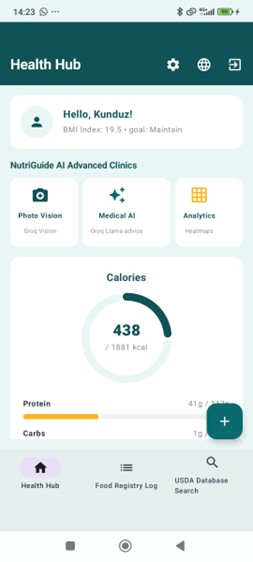
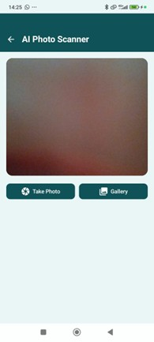
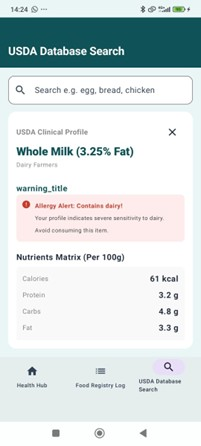
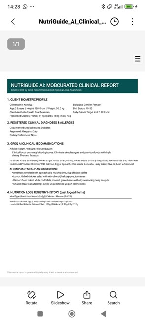
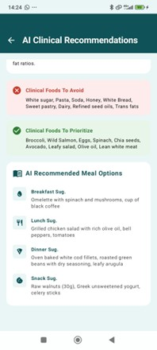

# 🥗 NutriGuide AI - Personalized Nutrition & Clinical Analysis

Мобильное приложение для платформы Android, разработанное как выпускная квалификационная работа. Приложение анализирует биометрические данные пользователя, ведет дневник питания и с помощью искусственного интеллекта (Groq API) генерирует персонализированные клинические рекомендации, а также распознает блюда по фотографиям.

## 🛠️ Стек технологий
* **Язык программирования:** Kotlin 2.0
* **UI Фреймворк:** Jetpack Compose
* **Архитектура:** MVVM (Model-View-ViewModel), Repository Pattern
* **Локальная база данных:** Room (SQLite)
* **Асинхронность:** Kotlin Coroutines, StateFlow
* **Сеть:** OkHttp, REST API
* **Искусственный интеллект:** Groq Cloud (Модели Llama 3.3 для текстовых рекомендаций и Llama 3.2 Vision для анализа фото)
* **Внешние API:** USDA FoodData Central (база данных продуктов)
* **Тестирование:** JUnit, MockWebServer, ComposeTestRule (57 успешно пройденных тестов)

## ✨ Ключевые возможности
* **Умный онбординг:** Расчет нормы калорий (BMR/TDEE) по формуле Миффлина-Сан Жеора с учетом диагнозов (диабет, гипертония) и аллергий.
* **AI-сканер еды (Photo Vision):** Распознавание блюд по фото и автоматический подсчет КБЖУ через нейросеть.
* **Клинический движок (Warning Engine):** Мгновенное предупреждение пользователя, если продукт содержит аллергены или опасен при его заболевании.
* **Генерация советов (Medical AI):** Создание персонального плана питания и списка рекомендованных/запрещенных продуктов.
* **Экспорт отчетов:** Формирование клинических PDF и CSV отчетов для предоставления лечащему врачу.
* **Оффлайн-режим:** Благодаря Room DB, история питания и профиль доступны без интернета.

## 📱 Скриншоты приложения

| Главный экран (Health Hub) | Сканер еды (AI Vision) | Предупреждение (Warning) | Отчет (PDF Export) |  AI Recommendation |
| :---: | :---: | :---: | :---: | :---: |
|  |  |  |  |  |

## 🧪 Тестирование
Проект покрыт тестами. В ходе разработки было успешно пройдено:
* **43 Unit-теста** (проверка формул расчета, логики предупреждений, парсинга JSON).
* **14 Интеграционных тестов** (проверка взаимодействия UI, БД Room и API с помощью MockWebServer).

## 💻 Как запустить проект локально
1. Клонируйте репозиторий:
   `git clone https://github.com/kunduz-ima/NutriGuide-AI.git`
2. Откройте проект в **Android Studio** (рекомендуется Ladybug или новее).
3. В корневой папке проекта создайте файл **`.env`** и добавьте ваши API-ключи:
   ```env
   GROQ_API_KEY=ваш_ключ_groq
   USDA_API_KEY=ваш_ключ_usda
